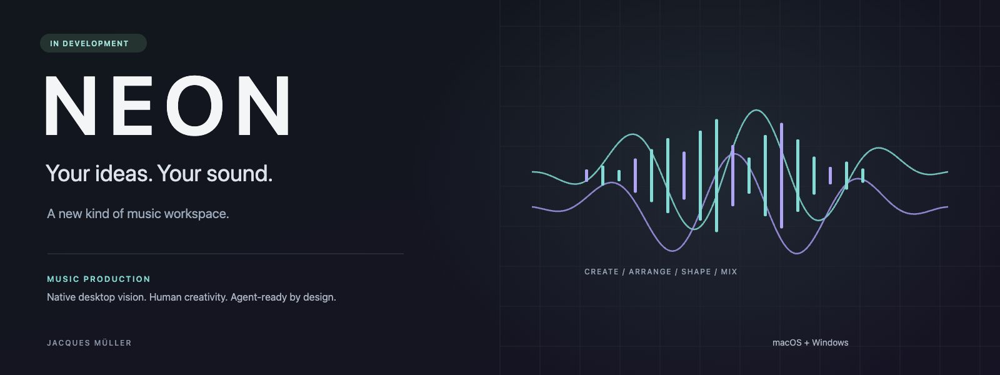
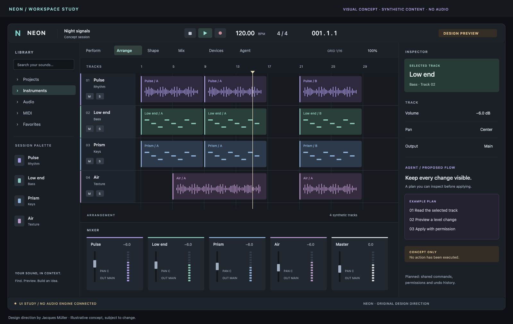

  

  <strong>Eine neue Musik-Workstation. Von der ersten Idee bis zum fertigen Track.</strong> 
  Eine eigenständige Desktop-DAW mit klarer Oberfläche und Agentensteuerung als Teil des Konzepts.

  <a href="#die-idee">Die Idee</a> ·
  <a href="#design">Design</a> ·
  <a href="#was-neon-werden-soll">Geplante Funktionen</a> ·
  <a href="#entwicklungsweg">Entwicklungsweg</a> ·
  <a href="#releases--downloads">Releases &amp; Downloads</a>

  <strong>In Entwicklung</strong> &nbsp; / &nbsp; Zielplattformen: macOS + Windows &nbsp; / &nbsp; Private Codebase

---

## Die Idee

Musik beginnt mit einem Rhythmus, einer Melodie oder einem Klang. NEON soll daraus einen zusammenhängenden kreativen Arbeitsprozess machen: Ideen mit Clips ausprobieren, in der Timeline zu einem Stück formen, Details bearbeiten und den Mix fertigstellen.

Das Projekt verbindet klassische Musikproduktion mit einer von Anfang an mitgedachten Agentenschnittstelle. Du arbeitest direkt mit Maus und Tastatur. Ein angebundener Agent soll dieselben freigegebenen Bearbeitungsfunktionen nutzen können — mit nachvollziehbaren Aktionen, klaren Berechtigungen und kontrollierbaren Änderungen.

**Die kreative Entscheidung bleibt bei dir.** Assistenz soll Arbeit abnehmen und Zusammenhänge zugänglich machen, während Projekt, Auswahl und Änderungen sichtbar bleiben.

NEON ist eine eigenständig entwickelte DAW von **Jacques Müller**. Dieses öffentliche Repo stellt die Idee und die visuelle Richtung vor und dient künftig als Anlaufstelle für Veröffentlichungen. Der Produktquellcode wird privat entwickelt.

## Design

  

<em>Visuelles Konzept mit synthetischen Inhalten. Kein Screenshot einer fertigen DAW und keine Audio-Demo.</em>

Die Gestaltung folgt einer ruhigen Studio-Ästhetik: dunkle, neutrale Arbeitsflächen, gut lesbare Beschriftungen und gezielte Akzente. Der Inhalt steht im Vordergrund — Spuren, Clips, Parameter und die aktuelle Auswahl.

| Gestaltung | Gedanke dahinter |
| :--- | :--- |
| **Cyan** | Fokus, Auswahl und aktive Arbeitsbereiche |
| **Violett** | Modulation und kreative Verknüpfungen |
| **Amber** | Ausstehende Aktionen und Entscheidungen |
| **Ein gemeinsamer Inspector** | Kontext zur Auswahl, ohne den Überblick über das Projekt zu verlieren |
| **Sichtbare Agentenaktionen** | Vorschläge prüfen, Änderungen anwenden und den Verlauf nachvollziehen |
| **Klare Zustände** | Beschriftungen und Symbole ergänzen Farben; Tastaturbedienung und Zugänglichkeit sind Entwicklungsziele |

Layout, Arbeitsbereich-Namen und visuelle Details können sich während der Entwicklung ändern.

## Was NEON werden soll

Die folgenden Bereiche beschreiben die **geplante Produktrichtung**, keine Liste bereits verfügbarer Funktionen.

| Arbeitsbereich | Geplantes Erlebnis |
| :--- | :--- |
| **Perform** | Clips und Szenen kombinieren, Ideen live ausprobieren und in ein Arrangement überführen |
| **Arrange** | Audio- und MIDI-Spuren auf einer Timeline organisieren und einen vollständigen Track aufbauen |
| **Shape** | Audio, Noten, Timing, Ausdruck und Automation gezielt bearbeiten |
| **Mix** | Pegel, Routing und Signalwege überblicken und den Mix ausarbeiten |
| **Devices** | Eigene Instrumente, Effekte, Signalketten und Modulation gestalten |
| **Library** | Projekte und Klangmaterial finden und im kreativen Kontext verwenden |
| **Agent** | Freigegebene Aktionen entdecken, Projektzustände lesen und Bearbeitungsschritte kontrolliert ausführen |

### Ein Projekt, gemeinsame Kontrolle

Oberfläche und Agent sollen auf derselben validierten Befehlsschicht arbeiten. Eine Änderung am Projekt soll denselben Zustand erzeugen, unabhängig davon, ob sie über die Oberfläche oder einen Agenten ausgelöst wird.

- **Nachvollziehbar:** Aktionen sollen ihren Umfang, ihr Ergebnis und mögliche Seiteneffekte offenlegen.
- **Kontrollierbar:** Lesen, Bearbeiten, Aufnahme und Export sollen eigene Berechtigungsgrenzen haben.
- **Rückgängig machbar:** Reversible Änderungen sollen an den gemeinsamen Undo-Verlauf angebunden sein.
- **Semantisch bedienbar:** Geplant ist eine MCP-Schnittstelle für strukturierte Befehle und Zustandsabfragen.

Die vollständige Abdeckung der ausgelieferten eigenen Funktionen ist ein Entwicklungsziel. Eine fertige MCP-Integration oder vollständige Agentenabdeckung wird hier noch nicht zugesagt.

### Musikproduktion als zusammenhängender Ablauf

Der geplante Kern umfasst Audio- und MIDI-Arbeit, Aufnahme, Editing, Automation, eigene Klangerzeugung und Effekte sowie Speichern, Wiederherstellen und Export. Die Entwicklung beginnt mit einem kleinen durchgängigen Produktionsablauf und wird schrittweise erweitert.

Externe Plugin-Formate, zusätzliche Plattformen und generative Klang- oder Vocal-Funktionen sind mögliche spätere Erweiterungen. Sie gehören derzeit nicht zu den zugesagten Release-Funktionen.

## Aktueller Stand

**NEON befindet sich in der Entwicklung. Es gibt hier noch keine öffentlich veröffentlichte, spielbare DAW.**

Die Arbeit konzentriert sich auf die eigenständige Architektur, technische Grundlagen, überprüfbare Schnittstellen und eine sichtbare native Oberfläche. macOS und Windows sind die vorgesehenen Desktop-Zielplattformen. Verbindliche Systemanforderungen und tatsächlich unterstützte Funktionen werden mit den jeweiligen Releases angegeben.

Die Bilder zeigen die visuelle Richtung. Sie belegen weder fertige Audiofunktionen noch eine bereits qualifizierte Anwendung auf beiden Plattformen. Es gibt noch keinen angekündigten Veröffentlichungstermin.

## Entwicklungsweg

| Etappe | Ziel |
| :--- | :--- |
| **01 · Sichtbarer Workspace** | Eigenes Design und natives UI-Framework für macOS und Windows; zunächst mit klar markierten Testinhalten |
| **02 · Erster vollständiger Track** | Ein kleiner Ablauf aus Klangerzeugung, Clips, Timeline, Speichern/Laden, Undo und Offline-Render |
| **03 · Alltagstaugliche Produktion** | Aufnahme, Editing, Automation, Routing, Mixer, Library und zugängliche Bedienung ausbauen |
| **04 · Kreative Tiefe** | Eigene Instrumente, Effekte, Modulation und Performance-Funktionen erweitern |
| **05 · Veröffentlichungen** | Stabilität, Installationspakete, Plattformprüfung und verständlich dokumentierte Releases |

Diese Etappen beschreiben die Richtung und sind kein Kalenderplan. Der Umfang einer Veröffentlichung richtet sich nach dem tatsächlich geprüften Stand.

## Releases & Downloads

**Aktuell ist hier noch kein öffentlicher Download verfügbar.** Sobald eine Version bereitsteht, findest du Installationsdateien und Hinweise direkt im Release-Bereich dieses Repos.

### [Zum Release-Bereich →](https://github.com/neophrythe/NEON-Project/releases)

Jede künftige Veröffentlichung soll transparent enthalten:

- Versionsnummer und Status, zum Beispiel Preview, Alpha oder stabile Version;
- Downloads für die tatsächlich geprüften Plattformen;
- unterstützte Systemversionen und Installationshinweise;
- neue Funktionen, Änderungen und bekannte Einschränkungen;
- Prüfsummen und vorhandene Signierungsinformationen.

Du kannst das Repo über **Watch → Custom → Releases** beobachten, um über spätere Veröffentlichungen informiert zu werden.

<strong>Für die Veröffentlichung: Hier später ein Release hinzufügen</strong>

Im GitHub-Bereich **Releases → Draft a new release** einen Versions-Tag anlegen, die Release Notes schreiben und die geprüften Installationspakete als Assets anhängen. Experimentelle Versionen als **Pre-release** kennzeichnen. Nur Dateien veröffentlichen, die für die öffentliche Verteilung vorgesehen sind.

Dieses Repo benötigt dafür keinen Produktquellcode. Solange die README keine feste Versionsnummer oder direkten Datei-Links enthält, führt der Release-Link weiterhin zum aktuellen Veröffentlichungsbereich.

## Fragen & Feedback

Ideen, Fragen zur Ausrichtung und späteres Release-Feedback sind über [GitHub Issues](https://github.com/neophrythe/NEON-Project/issues) willkommen. Bitte keine privaten Projekte, Aufnahmen, Zugangsdaten oder persönlichen Informationen veröffentlichen. Für künftige Fehlerberichte helfen Versionsnummer, Betriebssystem und nachvollziehbare Schritte.

## Projekt & Rechte

**Idee, Projektleitung und kreative Richtung: Jacques Müller.**

Dieses Repository veröffentlicht Projektinformationen und eigene Konzeptgrafiken. Es enthält keinen DAW-Quellcode und erteilt keine Open-Source-Lizenz für das Produkt. Nutzungs- und Vertriebsbedingungen einer späteren Anwendung werden mit deren Veröffentlichung bekanntgegeben.

NEON ist ein Arbeitsname. Das Projekt wird unabhängig entwickelt und ist keinem anderen DAW-Hersteller zugeordnet. Gezeigte Spuren und Clips sind synthetische Gestaltungselemente; sie enthalten keine Audioaufnahmen oder Soundbibliotheken.

---

<strong>NEON</strong> Your ideas. Your sound.

